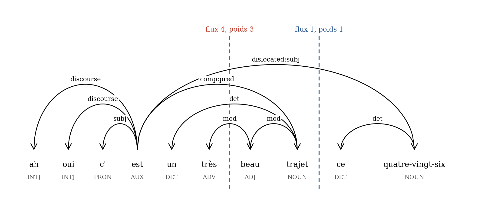
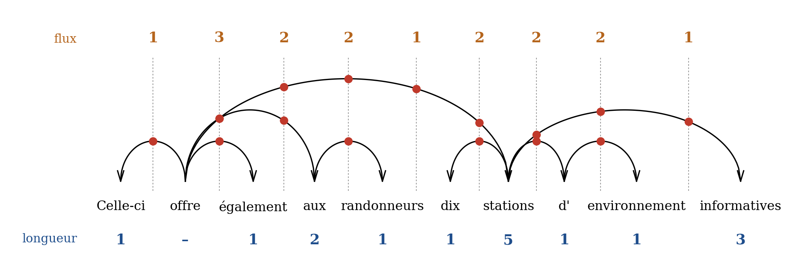
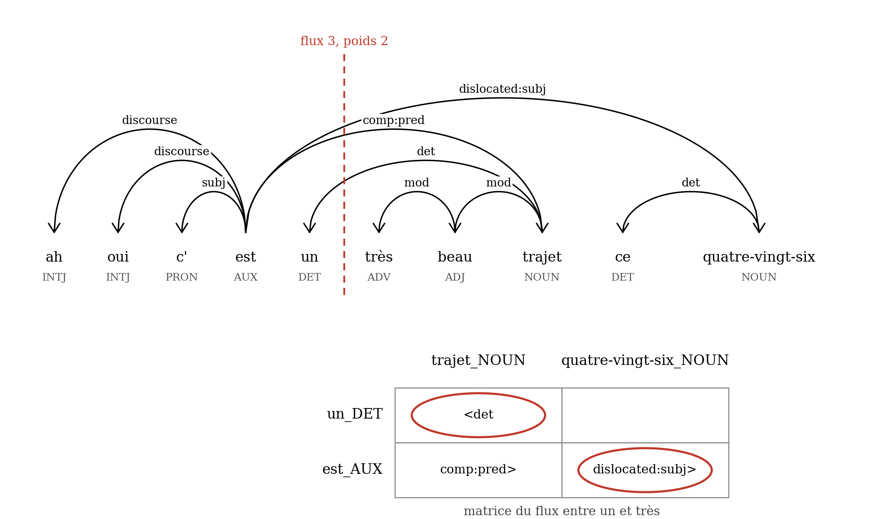
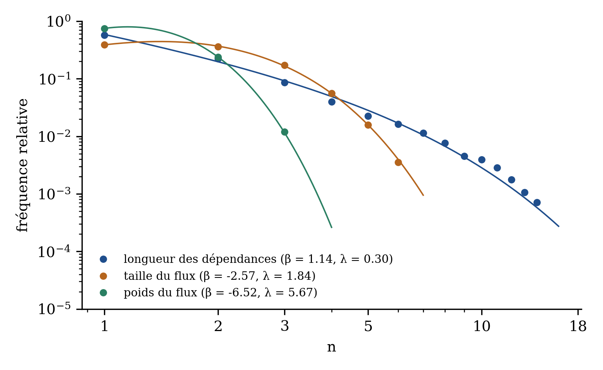
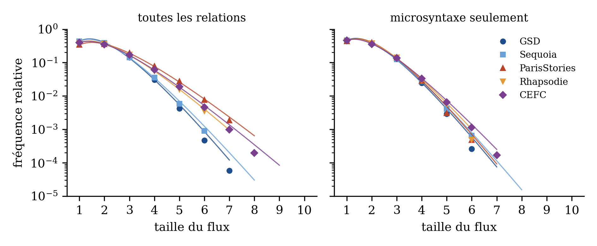
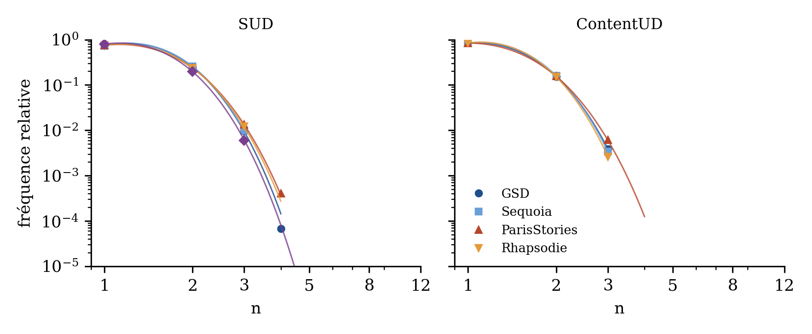
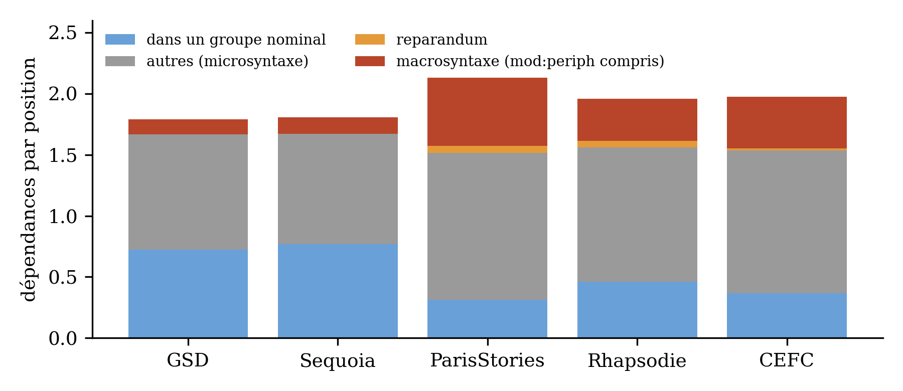
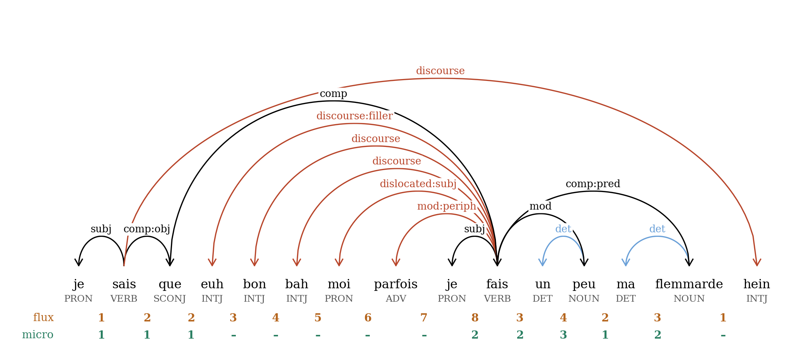

::: {.authors}
Sylvain Kahane^[Université Paris Nanterre, Modyco, CNRS ; IUF – Institut Universitaire de France ; [courriel].] et Kim Gerdes^[Université Paris-Saclay, CNRS, Laboratoire interdisciplinaire des sciences du numérique (LISN), Orsay, France ; [courriel].]
:::

::: {.abstract}
**Résumé :** Le flux de dépendance en un point d'une phrase est l'ensemble des dépendances syntaxiques qui relient un mot situé avant ce point à un mot situé après. Sa taille moyenne est égale à la longueur moyenne des dépendances, mais sa distribution renseigne directement sur la charge de la mémoire de travail. Nous comparons deux corpus écrits (GSD, Sequoia) et trois corpus oraux (ParisStories, Rhapsodie, CEFC-gold) du français annotés en dépendances (SUD), en mesurant pour des unités de même longueur la taille du flux, son poids (le nombre maximal de dépendances disjointes, qui mesure l'enchâssement central) et la longueur des dépendances, ainsi que le paramètre de coupure d'une loi de puissance tronquée, que nous interprétons comme la pression exercée par la mémoire de travail. À longueur égale, l'oral a un flux plus grand que l'écrit. Les relations macrosyntaxiques (marqueurs de discours, dislocations, parenthèses) expliquent la plus grande partie de ce surplus, les modifieurs antéposés au sujet le reste ; le poids du flux est le même partout. Contrairement à l'idée d'un oral syntaxiquement simple, l'oral n'est pas moins complexe que l'écrit au niveau microsyntaxique : sa complexité est seulement distribuée autrement.
:::

::: {.abstract}
**Mots-clés :** flux de dépendance, longueur des dépendances, complexité syntaxique, mémoire de travail, français parlé, macrosyntaxe, Surface-Syntactic Universal Dependencies
:::

::: {.abstract}
**Abstract:** The dependency flux at a point of a sentence is the set of syntactic dependencies linking a word before this point to a word after it. Its mean size equals the mean dependency length, but its distribution directly reflects the load on working memory. We compare two written (GSD, Sequoia) and three spoken (ParisStories, Rhapsodie, CEFC-gold) French dependency treebanks (SUD), measuring, for units of equal length, flux size, flux weight (the maximal number of disjoint dependencies, which measures centre embedding) and dependency length, together with the cut-off parameter of a truncated power law, which we interpret as the pressure exerted by working memory. At equal length, speech has a larger flux than writing. Macrosyntactic relations (discourse markers, dislocations, parentheticals) account for most of this surplus, modifiers placed before the subject for the rest; flux weight is the same everywhere. Contrary to the idea of a syntactically simple spoken language, speech is not less complex than writing at the microsyntactic level: its complexity is only distributed differently.
:::

::: {.abstract}
**Key words:** dependency flux, dependency length, syntactic complexity, working memory, spoken French, macrosyntax, Surface-Syntactic Universal Dependencies
:::

::: {.abstract}
**Rezumat:** Fluxul de dependență într-un punct al unei propoziții este mulțimea dependențelor sintactice care leagă un cuvânt aflat înaintea acestui punct de un cuvânt aflat după el. Mărimea sa medie este egală cu lungimea medie a dependențelor, dar distribuția sa reflectă direct încărcarea memoriei de lucru. Comparăm două corpusuri scrise (GSD, Sequoia) și trei corpusuri orale (ParisStories, Rhapsodie, CEFC-gold) ale limbii franceze adnotate în dependențe (SUD), măsurând, pentru unități de aceeași lungime, mărimea fluxului, greutatea sa (numărul maxim de dependențe disjuncte, care măsoară încastrarea centrală) și lungimea dependențelor, precum și parametrul de tăiere al unei legi de putere trunchiate, pe care îl interpretăm ca presiunea exercitată de memoria de lucru. La lungime egală, oralul are un flux mai mare decât scrisul. Relațiile macrosintactice (mărci discursive, dislocări, paranteze) explică cea mai mare parte a acestui surplus, iar modificatorii antepuși subiectului restul; greutatea fluxului este aceeași peste tot. Contrar ideii unui oral simplu din punct de vedere sintactic, oralul nu este mai puțin complex decât scrisul la nivel microsintactic: complexitatea sa este doar distribuită altfel.
:::

::: {.abstract}
**Cuvinte-cheie:** flux de dependență, lungimea dependențelor, complexitate sintactică, memorie de lucru, franceza vorbită, macrosintaxă, Surface-Syntactic Universal Dependencies
:::

# 1. Introduction

On oppose souvent un oral « simple », fait d'énoncés courts et juxtaposés, à un écrit « complexe », riche en subordination et en syntagmes nominaux étendus. La longueur des phrases est d'ailleurs une bonne mesure de la complexité des textes écrits : elle est l'une des variables les plus prédictives de la lisibilité et de la difficulté des textes pour les apprenants (François 2011). Mais elle se prête mal à la comparaison de l'oral et de l'écrit, parce que les unités de l'oral ne sont pas des phrases graphiques et que leur segmentation repose sur d'autres critères (Blanche-Benveniste 1990 ; Pietrandrea et al. 2014). L'oral a en outre ses propres structures (dislocations, marqueurs de discours, reprises, reformulations), qui ne se laissent pas réduire à de l'écrit simplifié.

Pour comparer les deux modalités, il faut une mesure qui soit liée aux contraintes cognitives du traitement et qui puisse être calculée à longueur d'énoncé égale. Nous utilisons le *flux de dépendance* (Kahane 2001 ; Botalla 2014 ; Kahane et al. 2017 ; Yan 2021) : en chaque point d'une phrase, l'ensemble des dépendances qui relient un mot situé avant ce point à un mot situé après. La figure 1 en donne un exemple, un énoncé de dix mots du corpus Rhapsodie. Entre *trajet* et *ce*, une seule dépendance enjambe la coupure, celle qui rattache le sujet disloqué *quatre-vingt-six* au verbe *est* : le flux est de taille 1. Entre *très* et *beau*, quatre dépendances l'enjambent : le verbe *est* attend son attribut *trajet* et son sujet disloqué, le déterminant *un* attend le nom *trajet*, l'adverbe *très* attend l'adjectif *beau* ; le flux est de taille 4. Trois de ces dépendances ne partagent aucun mot (*est*–*quatre-vingt-six*, *un*–*trajet*, *très*–*beau*) : trois constructions sont ouvertes en même temps, et le flux est de *poids* 3. Le flux est ce qui doit être maintenu en mémoire de travail pendant la production ou la compréhension. Nous montrons trois choses : (i) à longueur égale, l'oral a un flux plus grand que l'écrit, et ce surplus tient pour l'essentiel aux relations macrosyntaxiques et aux modifieurs antéposés au sujet ; (ii) le poids du flux, qui mesure l'enchâssement central, est le même à l'oral et à l'écrit ; (iii) les deux modalités ne remplissent pas le flux avec les mêmes relations : l'écrit le remplit de dépendances internes aux groupes nominaux, l'oral de dépendances verbales et macrosyntaxiques.

{width=16cm}

# 2. Longueur de dépendance et flux

## 2.1. La minimisation de la longueur des dépendances

La longueur d'une dépendance est la distance, en mots, entre un gouverneur et son dépendant. De nombreux travaux ont montré que les langues tendent à minimiser cette longueur (Hudson 1995 ; Gibson 1998 ; Ferrer-i-Cancho 2004 ; Liu 2008 ; Futrell, Mahowald & Gibson 2015), et cette tendance (*dependency length minimization*, DLM) explique plusieurs propriétés de l'ordre des mots (Temperley 2008).

La DLM explique aussi la préférence pour placer les compléments courts avant les longs, déjà formulée par Buffier (1709) et redécouverte sous les noms de *heavy constituent shift* (Ross 1967) ou de minimisation des domaines (Hawkins 1994, 2004). En (1a), phrase du corpus GSD, la somme des distances entre le verbe *offre* et les têtes de ses trois compléments vaut 1 + 2 + 5 = 8 ; dans l'ordre inverse (1b), elle vaut 2 + 6 + 8 = 16, les autres dépendances restant de longueur égale.

::: {.ex}
\(1\) a. Celle-ci offre également aux randonneurs dix stations d'environnement informatives.\
  b. Celle-ci offre dix stations d'environnement informatives aux randonneurs également.
:::

Elle rend compte enfin de la difficulté de l'enchâssement central. Chomsky (1957 : 21) a introduit cette notion pour montrer que l'anglais n'est pas un langage à états finis : les relatives peuvent en principe être enchâssées sans limite. Elles ne le peuvent pas en pratique, et trois niveaux d'enchâssement donnent déjà des phrases incompréhensibles (Chomsky & Miller 1963 ; Reich 1969) :

::: {.ex}
\(2\) The rat that the cat that the dog worried killed ate the malt.
:::

La traduction littérale de (2) en français est tout aussi incompréhensible (3a), alors que la passivation et l'inversion du sujet permettent d'exprimer le même contenu sans enchâssement central (3b) :

::: {.ex}
\(3\) a. Le rat que le chat que le chien inquiétait a tué mangeait le malt.\
  b. Le malt était mangé par le rat qui a été tué par le chat qu'inquiétait le chien.
:::

Les dépendances sont beaucoup plus longues en (3a) qu'en (3b) (celle entre *rat* et *mangeait* passe de 10 à 3), mais la DLM n'explique pas pourquoi l'enchâssement central devient inacceptable au-delà de deux niveaux, alors que de longues dépendances restent possibles. C'est ce que permet d'aborder le flux.

## 2.2. Taille du flux

Le flux en une position entre deux mots est l'ensemble des dépendances qui relient un mot situé avant cette position à un mot situé après ; sa *taille* est le nombre de ces dépendances. La figure 2 montre la relation entre taille du flux et longueur de dépendance : chaque point rouge est l'intersection d'une dépendance et d'une position inter-mots. La somme des points d'une colonne donne la taille du flux en cette position ; la somme des points d'une dépendance donne sa longueur. Les deux totaux sont égaux et, comme une phrase de *n* mots a *n* − 1 dépendances et *n* − 1 positions inter-mots, la longueur moyenne des dépendances est égale à la taille moyenne du flux. Minimiser la longueur des dépendances, c'est minimiser la taille du flux.

{width=16cm}

Les deux formulations n'ont pas la même interprétation. Pour la DLM, une dépendance longue est coûteuse parce que l'information se dégrade en mémoire pendant qu'on attend le second mot (Gibson 1998) ; pour la minimisation du flux, ce qui est coûteux est le nombre de dépendances à traiter simultanément. Les deux interprétations sont plausibles, mais la mémoire de travail, qui comprend la mémoire à court terme (Cowan 2008), a une capacité très strictement limitée (Miller 1956 ; Cowan 2001 ; Engle 2002) : nous faisons donc l'hypothèse que les contraintes portent davantage sur la taille du flux que sur la longueur des dépendances. Une mémoire de travail limitée explique d'ailleurs aussi la dégradation de l'information : les dépendances très longues chargent la mémoire et franchissent souvent mal le goulot d'étranglement que décrivent Christiansen & Chater (2016).

## 2.3. Poids du flux

Le flux a une structure. Des dépendances qui partagent un mot à l'une de leurs extrémités forment un *bouquet* et peuvent être regroupées : un verbe et ses compléments en attente ne représentent qu'une unité à maintenir. Des dépendances qui ne partagent aucun mot sont *disjointes* et doivent être maintenues séparément ; ce sont elles qui caractérisent l'enchâssement central. En (3a), après *chien*, trois sujets attendent leurs verbes respectifs (*rat*, *chat*, *chien*), soit trois dépendances disjointes. Le *poids* du flux est le nombre maximal de dépendances deux à deux disjointes qu'il contient (Kahane et al. 2017). Botalla (2014) représente le flux en une position par une matrice dont les lignes sont les mots de gauche, les colonnes les mots de droite et les cases les dépendances : le poids est le plus grand nombre de cases qu'on peut choisir sans prendre deux fois la même ligne ou la même colonne. La figure 3 reprend l'énoncé de la figure 1, coupé entre *un* et *très* : trois dépendances enjambent la coupure (*est*–*trajet*, *est*–*quatre-vingt-six*, *un*–*trajet*), soit un flux de taille 3 ; mais les deux premières partagent *est* et la première et la troisième partagent *trajet*, et l'on ne peut en choisir que deux sans mot commun : le poids est 2. Dans la matrice, les deux cases retenues ne sont ni sur la même ligne ni sur la même colonne. C'est sous cette forme, avec la catégorie des mots et la relation de chaque case, que nous analyserons la composition des flux (section 4.3).

{width=14cm}

## 2.4. L'indice de saturation

Soit *p*(*n*) la fréquence relative de la valeur *n* d'une mesure : la part des dépendances de longueur *n*, ou la part des positions où le flux a une taille ou un poids *n*. Les distributions de la taille et du poids du flux décroissent beaucoup plus vite que celle de la longueur des dépendances : la figure 4 montre les trois distributions dans le corpus Rhapsodie, pour les unités de 10 à 19 mots. Nous les décrivons par une loi de puissance avec coupure exponentielle, *p*(*n*) ∝ *n*^−β^ e^−λ*n*^, estimée par maximum de vraisemblance.^[L'estimation maximise la vraisemblance des effectifs observés (algorithme de Nelder–Mead de la bibliothèque SciPy) ; les calculs ont été programmés avec l'assistant Claude (Anthropic) et sont vérifiables sur le site compagnon (https://typometrics.github.io/flux-oral-ecrit/), qui donne aussi les corpus tels qu'ils ont été analysés.] Le paramètre λ mesure la vitesse à laquelle les grandes valeurs deviennent rares : loin du mode, chaque incrémentation de *n* d'une unité divise *p*(*n*) par e^λ^ environ. Dans l'étude des systèmes complexes, une telle coupure signale qu'une ressource est limitée et que le système sature quand on s'en approche (Mandelbrot 1953 ; Amaral *et al.* 2000) ; nous appellerons donc λ l'*indice de saturation* de la mesure. Pour la longueur des dépendances, β vaut 1,1 et λ 0,30 : la distribution est proche d'une loi de puissance et ne sature que lentement, ce qui laisse place à des dépendances longues (Petrini & Ferrer-i-Cancho 2025). Pour la taille du flux, β est négatif (−2,6) : la distribution croît jusqu'à un mode de 2 avant de décroître, et c'est λ (1,85) qui caractérise la décroissance ; une taille de 5 est déjà vingt-cinq fois plus rare qu'une taille de 2. Pour le poids, la saturation est encore plus brutale (λ = 5,6) : un poids de 3 est vingt fois plus rare qu'un poids de 2, et un poids de 4 cent fois plus rare qu'un poids de 3. Nous interprétons cet indice de saturation, pour la taille et surtout pour le poids du flux, comme la *pression exercée par la mémoire de travail* sur la production : un locuteur peut accumuler les dépendances en attente, mais chaque dépendance supplémentaire se paie à un taux exponentiel.

{width=12cm}

# 3. Données et méthode

## 3.1. Corpus et prétraitement

Nous utilisons quatre corpus arborés en *Surface-Syntactic Universal Dependencies* (SUD ; Gerdes *et al.* 2018), dans leur dernière version (v2.19, novembre 2026), et le corpus CEFC-gold du projet Orféo (Benzitoun, Debaisieux & Deulofeu 2016 ; Kahane & Gerdes 2020), annoté dans un schéma très proche de SUD. GSD (Guillaume, de Marneffe & Perrier 2019) est une collecte de textes du web faite par Google, dont les genres ne sont pas documentés ; Sequoia (Candito & Seddah 2012) réunit des articles de *L'Est républicain*, des notices médicales, des débats du Parlement européen et des articles de Wikipédia. ParisStories est un corpus de récits personnels sollicités ; Rhapsodie (Lacheret *et al.* 2014) couvre des genres variés (entretiens, descriptions, discussions, discours) ; CEFC-gold réunit des conversations, des entretiens et des interactions de service issus des corpus TCOF, CLAPI, Valibel et C-ORAL-ROM. L'annotation de ParisStories et de Rhapsodie a été révisée pour cette étude, en particulier pour les constructions non projectives et les reprises. La ponctuation est retirée, et nous ne gardons que les unités d'au moins trois mots : pour deux mots, le flux est toujours de taille 1.

Les unités de l'oral ne sont pas des phrases graphiques, mais des *unités illocutoires* (Benzitoun *et al.* 2010 ; Pietrandrea *et al.* 2014). La principale différence est que deux propositions principales coordonnées forment deux unités illocutoires à l'oral, alors qu'elles forment une seule phrase à l'écrit si elles ne sont pas séparées par un point. Nous segmentons donc l'écrit comme l'oral, en coupant les coordinations et parataxes de propositions dépendant de la racine, sauf quand le sujet est partagé, et seulement quand les deux parties restent continues. Ce découpage fait passer GSD de 16 328 phrases de 21,2 mots en moyenne à 18 456 unités de 18,7 mots, et Sequoia de 2 857 phrases de 21,1 mots à 3 185 unités de 18,9 mots (tableau 1). Comme toutes les mesures croissent avec la longueur de l'unité (Ferrer-i-Cancho & Liu 2014 ; Jiang & Liu 2015), nous comparons les corpus à longueur égale : principalement les unités de 10 à 19 mots, et aussi de 10 à 29 mots.

| Corpus | Modalité | Unités | Mots | Longueur moyenne | Macrosyntaxe | dont mod:periph | Reparandum | Unités commençant par une conjonction |
|:--|:--|--:|--:|--:|--:|--:|--:|--:|
| GSD | écrit | 18 456 | 344 730 | 18,7 | 1,7 % | 1,6 % | 0 % | 7,4 % |
| Sequoia | écrit | 3 185 | 60 084 | 18,9 | 1,9 % | 1,5 % | 0 % | 9,6 % |
| ParisStories | oral | 2 594 | 33 793 | 13,0 | 14,0 % | 3,1 % | 2,3 % | 34,5 % |
| Rhapsodie | oral | 2 699 | 34 099 | 12,6 | 9,0 % | 2,5 % | 2,6 % | 22,2 % |
| CEFC-gold | oral | 17 638 | 163 047 | 9,2 | 12,3 % | 3,5 % | 1,3 % | 18,6 % |

: Tableau 1 : Les corpus (unités d'au moins trois mots, ponctuation retirée ; GSD et Sequoia après segmentation). Macrosyntaxe (y compris les mod:periph, section 3.2) et reparandum : part des dépendances ; dernière colonne : part des unités dont le premier mot est une conjonction de coordination.

## 3.2. Microsyntaxe et macrosyntaxe

Selon Christiansen & Chater (2016), le traitement du langage comporte plusieurs niveaux de goulot d'étranglement, et les relations entre énoncés ne sont pas gérées au même niveau que les relations à l'intérieur d'un énoncé. Nous faisons l'hypothèse que la microsyntaxe et la macrosyntaxe (Blanche-Benveniste 1990) ne sont pas gérées au même niveau et que les relations macrosyntaxiques ne subissent pas la pression de la mémoire de travail qui traite la microsyntaxe. Les relations macrosyntaxiques sont, dans l'annotation SUD, les marqueurs de discours (`discourse`), les dislocations (`dislocated`), les vocatifs (`vocative`) et les parenthèses et autres parataxes (`parataxis`).^[Dans CEFC-gold, les relations correspondantes sont `dm`, `parenth` et `periph`.] Mais ce ne sont pas les seules à échapper à la rection du verbe. Dans l'approche de Blanche-Benveniste (1990), reprise par Benzitoun *et al.* (2010), les éléments antéposés au sujet, comme *quand tu mets la farine* et *au final* dans *en fait quand tu mets la farine au final ça se décolle* (ParisStories), sont des îlots qui ne font pas partie du noyau de la construction verbale. Nous les traitons donc aussi comme macrosyntaxiques : tout modifieur (`mod`, `udep`) d'un verbe placé avant le sujet de ce verbe est réétiqueté `mod:periph`, à l'oral comme à l'écrit. Ces modifieurs antéposés représentent 1,5 à 1,6 % des dépendances de l'écrit et 2,5 à 3,5 % de celles de l'oral (tableau 1).

Nous calculons toutes les mesures deux fois : sur les unités illocutoires avec toutes leurs relations, et sur leurs *composantes illocutoires* (Benzitoun *et al.* 2010), obtenues en coupant toutes les dépendances macrosyntaxiques, `mod:periph` compris, et qui ne contiennent plus que des dépendances microsyntaxiques. Un segment ainsi détaché peut être long, comme une parenthèse ou un élément disloqué : s'il compte au moins trois mots, il devient une composante à part entière, mesurée et classée selon sa propre longueur ; sinon, il est simplement retiré. La composante hôte, débarrassée de ces segments, est renumérotée et classée selon sa nouvelle longueur. Ainsi, dans l'énoncé de la figure 1, *ah*, *oui* et *ce quatre-vingt-six* sont retirés, et il reste *c'est un très beau trajet*, six mots dont le flux ne dépasse plus 3.

Le cas des reprises (`reparandum`) et des reformulations (`conj:reform`) est différent : ce sont a priori des relations microsyntaxiques, mais propres à l'oral. Une reprise est un segment abandonné puis repris, à l'identique ou presque, comme le premier *c'était* de la figure 5 ; une reformulation est un segment remplacé par un autre qui occupe la même place syntaxique sans l'annuler, comme *super spacieux* qui reformule *super bien*. En SUD, la reprise dépend du segment qui la remplace par la relation `reparandum`, et la reformulation est une relation entre deux conjoints, où le deuxième reformule le premier (`conj:reform`). On peut supposer que les reprises sont effacées immédiatement de la mémoire de travail (les auditeurs les remarquent à peine), alors que les reformulations sont traitées et que le destinataire construit un cumul ou un compromis des différentes formulations (Blanche-Benveniste 1990). Nous donnons aussi les mesures sans les reprises, retirées comme les segments macrosyntaxiques.

{width=16cm}

## 3.3. Caractéristiques des corpus

En SUD, les mots fonctionnels (prépositions, auxiliaires, conjonctions de subordination) sont les têtes de leur groupe, ce qui donne des dépendances plus courtes qu'en UD et des distributions de longueurs plus régulières (Petrini & Ferrer-i-Cancho 2025). Pour le poids du flux, nous utilisons aussi une vue restreinte aux mots pleins (ContentUD) : l'arbre UD dont on retire les mots fonctionnels (déterminants, prépositions, auxiliaires, copules, conjonctions), pour nous concentrer sur les relations qui, selon nous, créent réellement de la complexité pour l'interlocuteur.^[Pour les corpus oraux, la vue ContentUD est calculée sur la conversion automatique en UD fournie par Grew-match (corpus `UD_French-…@conv`) ; pour les corpus écrits segmentés, qui n'ont pas de version convertie, elle est dérivée de l'arbre SUD par nos soins. La longueur des unités est toujours comptée en mots SUD. CEFC-gold n'a pas de vue ContentUD.]

Le tableau 1 résume ce qui distingue les corpus. Un cinquième à un tiers des unités orales commencent par une conjonction de coordination, contre moins d'une sur dix à l'écrit (même après notre segmentation). Les relations macrosyntaxiques représentent 9 à 14 % des dépendances de l'oral et moins de 2 % de celles de l'écrit, où ce sont presque uniquement des modifieurs antéposés ; les reprises, 1,3 à 2,6 % à l'oral et aucune à l'écrit. Les marqueurs de discours sont pour moitié des hésitations : *euh* représente 49 % des dépendances `discourse` de ParisStories et 53 % de celles de Rhapsodie. Nos corpus ne couvrent qu'une partie du continuum de Koch & Oesterreicher (2001), qui va de l'immédiat communicatif de la conversation à la distance communicative du texte élaboré, ni des genres du discours (Bakhtine 1984) : ni littérature, aux phrases longues et a priori complexes, ni écrits de réseaux sociaux, plus proches de l'oral.

# 4. Résultats

## 4.1. Taille du flux et longueur des dépendances

Le tableau 2 donne les mesures pour les unités de 10 à 19 mots, avec toutes les relations et pour la microsyntaxe seule. Avec toutes les relations, les trois corpus oraux ont un flux plus grand que les deux corpus écrits (2,0 à 2,1 dépendances par position contre 1,8) et un indice de saturation nettement plus faible : les flux de grande taille y sont plus fréquents. Pour la microsyntaxe seule, les cinq corpus se rejoignent : le flux moyen de l'oral ne dépasse plus celui de l'écrit que de 0,03 à 0,05, et l'indice de saturation de ParisStories et de Rhapsodie rejoint celui de GSD et de Sequoia ; seul celui de CEFC-gold reste nettement plus faible.^[Si l'on retire les marqueurs de discours, les dislocations, les vocatifs et les parataxes mais qu'on garde les modifieurs antéposés, le surplus de l'oral ne diminue que des deux tiers (1,89 à 1,91 contre 1,79 et 1,80).] La figure 6 montre les deux situations : avec la macrosyntaxe, les courbes de l'oral s'écartent de celles de l'écrit à partir d'un flux de 4 ; pour la microsyntaxe seule, les cinq corpus suivent pratiquement la même courbe. Le résultat est le même pour les unités de 10 à 29 mots, et retirer en plus les reprises ne change presque rien : une reprise est courte, et son retrait enlève autant de positions que de dépendances.

| Corpus | Unités | Flux moyen | λ~flux~ | λ~longueur~ | Poids moyen | λ~poids~ |
|:--|:-:|:-:|:-:|:-:|:-:|:-:|
| GSD | 7 733 / 8 645 | 1,79 / 1,73 | 2,50 / 2,59 | 0,24 / 0,29 | 1,27 / 1,24 | 6,4 / 6,3 |
| Sequoia | 1 097 / 1 299 | 1,81 / 1,73 | 2,32 / 2,42 | 0,19 / 0,26 | 1,28 / 1,24 | 6,4 / 6,4 |
| ParisStories | 989 / 858 | 2,13 / 1,78 | 1,61 / 2,59 | 0,32 / 0,58 | 1,26 / 1,20 | 5,6 / 6,0 |
| Rhapsodie | 902 / 832 | 1,96 / 1,78 | 1,84 / 2,39 | 0,30 / 0,44 | 1,26 / 1,23 | 5,7 / 5,2 |
| CEFC-gold | 4 599 / 3 547 | 1,97 / 1,76 | 1,68 / 2,15 | 0,35 / 0,65 | 1,21 / 1,15 | 6,4 / 6,4 |

: Tableau 2 : Unités de 10 à 19 mots, SUD : toutes les relations / microsyntaxe seule. Flux et poids moyens par position inter-mots ; λ : indice de saturation. Erreurs types estimées par rééchantillonnage des unités : 0,002 à 0,017 pour les moyennes, 0,02 à 0,07 pour λ~flux~, 0,005 à 0,025 pour λ~longueur~, 0,1 à 0,4 pour λ~poids~.

{width=15cm}

La longueur des dépendances donne une image différente. Comme la taille moyenne du flux est égale à la longueur moyenne des dépendances, l'oral a aussi des dépendances un peu plus longues en moyenne ; mais leur distribution sature plus vite (λ~longueur~ de 0,30 à 0,35 à l'oral contre 0,19 et 0,24 à l'écrit, toutes relations comprises) : l'oral a plus de dépendances de longueur moyenne et moins de dépendances très longues. La longueur des dépendances et le flux ne disent donc pas la même chose : selon la première mesure, l'oral serait plutôt plus simple que l'écrit (moins de longues dépendances) ; selon la seconde, il est plus complexe (plus de dépendances simultanées), et la décomposition en microsyntaxe et macrosyntaxe montre d'où vient ce surplus.

## 4.2. Le poids du flux

Le poids moyen du flux est pratiquement le même dans les cinq corpus (de 1,21 à 1,28 pour 10 à 19 mots), et il est même un peu plus faible à l'oral pour la microsyntaxe seule. L'indice de saturation du poids est plus faible dans ParisStories et Rhapsodie avec toutes les relations ; pour la microsyntaxe seule, il rejoint celui de l'écrit pour ParisStories mais pas pour Rhapsodie, où les segments détachés, courts et peu enchâssés, semblent avoir emporté une partie des poids élevés. Dans la vue limitée aux mots pleins (ContentUD), qui neutralise les différences de mots fonctionnels, la distribution du poids est quasiment identique dans les quatre corpus pour lesquels elle est disponible (figure 7) : pour les unités de 10 à 19 mots, 84 à 85 % des positions ont un poids 1, 15 à 16 % un poids 2 et au plus 0,6 % un poids 3 ; la plus grande distance de variation totale entre deux corpus est de 0,010, ce qui est l'ordre de grandeur de ce que produit le seul échantillonnage. Elle reste faible pour 10 à 29 mots (0,029) et augmente pour l'ensemble des unités d'au moins 10 mots (0,075), où pèsent les longues phrases de l'écrit.

{width=16cm}

Le poids maximal atteint dans une unité est remarquablement bas. Sur toutes les unités illocutoires, en SUD avec toutes les relations, il ne dépasse jamais 5, et un poids de 4 n'est atteint que dans 0,6 à 1,7 % des unités de GSD, Sequoia, ParisStories et Rhapsodie et dans 0,2 % de celles de CEFC-gold.^[Ces unités sont listées sur le site compagnon pour vérification.] La limitation de l'enchâssement central est la même à l'oral et à l'écrit.

## 4.3. De quoi le flux est-il fait ?

Les mesures précédentes ne disent pas de quelles dépendances le flux est composé, ni surtout si des dépendances *disjointes de même nature* y sont maintenues ensemble : ce sont elles qui posent le plus de problèmes quand il faut les traiter simultanément, comme les trois sujets en attente de la phrase (2). Nous examinons donc la composition des flux, à partir des matrices de la section 2.3, dans les unités de 10 à 19 mots et avec toutes les relations.

Une dépendance est dite interne à un groupe nominal si son gouverneur est un nom ou un pronom, ou est dominé par un nom sans passer par un verbe, ce qui revient essentiellement à exclure les relatives. À l'écrit, 0,73 (GSD) et 0,77 (Sequoia) dépendances par position sont internes à un groupe nominal, soit plus de 40 % du flux ; à l'oral, 0,31 (ParisStories), 0,46 (Rhapsodie) et 0,37 (CEFC-gold), soit 15 à 24 % du flux. Les relations macrosyntaxiques, modifieurs antéposés compris, représentent au contraire 0,34 à 0,55 dépendance par position à l'oral et 0,12 à 0,14 à l'écrit (figure 8). La figure 9 montre un énoncé de ParisStories où les marqueurs de discours *euh*, *bon* et *bah*, le sujet disloqué *moi* et le modifieur antéposé *parfois* sont rattachés au verbe *fais* et *hein* au verbe principal *sais* : ils forment des bouquets qui font monter la taille du flux jusqu'à 8, alors que le flux microsyntaxique ne dépasse pas 3.

{width=14cm}

{width=16cm}

Les configurations de dépendances disjointes diffèrent aussi. Nous les relevons dans la vue limitée aux mots pleins, où les dépendances internes aux groupes ne comptent plus, en chaque position et selon la catégorie des deux gouverneurs. En (4), tirée de GSD, après *grande*, le nom *qualité* est attendu par son adjectif et le nom *Travail* attend son participe *exécuté* ; en (5), tirée de Rhapsodie, après *qu'*, deux verbes sont attendus, *arrive* par *qu'* et *aurai* par *ça* et *quoi*.

::: {.ex}
\(4\) **Travail**~1~ de très grande~2~ | **qualité**~2~ exécuté~1~ par un imprimeur artisan passionné.\
\(5\) avec ça~2~, quoi~2~ qu'~1~ | il **arrive**~1~, j'**aurai**~2~ un métier
:::

Deux dépendances disjointes gouvernées par deux noms sont présentes dans 2,9 % (GSD) et 3,4 % (Sequoia) des positions à l'écrit, mais dans 1,2 et 1,6 % des positions à l'oral ; deux dépendances disjointes gouvernées par deux verbes, dans 1,4 et 2,0 % des positions à l'écrit et dans 3,5 et 2,5 % à l'oral. Dans tous les corpus, les paires de gouverneurs de même catégorie sont nettement plus rares que les paires mixtes (un nom et un verbe : 6,3 à 9,0 % des positions), ce qui va dans le sens d'une difficulté particulière à traiter simultanément deux relations disjointes du même type.^[Si les catégories des deux gouverneurs étaient indépendantes, avec des parts *p* de noms et *q* de verbes, on attendrait *p*² paires de noms, *q*² paires de verbes et 2*pq* paires mixtes, soit deux fois la moyenne géométrique des deux premières : les paires mixtes observées sont 1,6 (Rhapsodie) à 2,3 (GSD) fois plus nombreuses que cette attente.] Un sujet, un objet et un complément oblique deux à deux disjoints ne se rencontrent jamais à l'écrit dans cette vue, et seulement une fois dans ParisStories et deux fois dans Rhapsodie.

# 5. Discussion

À longueur d'unité égale, l'oral a un flux plus grand que l'écrit et un indice de saturation plus faible. Ce surplus est entièrement fait de relations macrosyntaxiques : marqueurs de discours, éléments disloqués, parenthèses et modifieurs antéposés au sujet, deux fois plus fréquents à l'oral. Ces relations partent presque toutes du verbe principal et forment des bouquets, si bien qu'elles augmentent la taille du flux sans augmenter son poids. Pour la microsyntaxe seule, la taille moyenne du flux de l'oral ne dépasse celle de l'écrit que de peu, son indice de saturation est le même (sauf dans CEFC-gold), son poids est un peu plus faible, et la distribution du poids dans la vue limitée aux mots pleins est la même dans les quatre corpus.

Ce résultat est compatible avec l'hypothèse de Christiansen & Chater (2016) selon laquelle le traitement comporte plusieurs niveaux de goulot d'étranglement : la macrosyntaxe n'est pas soumise au même type de pression que la microsyntaxe, car les deux ne sont pas traitées au même niveau. Il conforte aussi notre choix de compter les modifieurs antéposés au sujet dans la macrosyntaxe : si on les laisse dans la microsyntaxe, l'oral garde un surplus de flux et un indice de saturation plus faible ; si on les en retire, à l'oral comme à l'écrit, les deux modalités ont le même indice de saturation. Le flux fournit ainsi un critère quantitatif pour la frontière entre microsyntaxe et macrosyntaxe, qui rejoint l'analyse de Blanche-Benveniste (1990). La longueur des dépendances, elle, conduit à une conclusion opposée (l'oral aurait moins de dépendances très longues), parce qu'elle mesure une autre chose : la distance entre deux mots liés, sans tenir compte de ce qui est maintenu en même temps.

Ces conclusions dépendent de choix d'annotation et de traitement. En SUD comme en UD, les marqueurs de discours et les éléments disloqués qui portent sur la phrase sont rattachés au verbe principal, et un autre rattachement changerait la taille du flux ; retirer les segments macrosyntaxiques plutôt que leurs seules dépendances change les moyennes de 0,2 (section 3.2) ; la correspondance entre les relations de CEFC-gold et celles de SUD reste approximative, ce qui explique sans doute que son indice de saturation reste à part. Elles dépendent aussi de la segmentation des corpus oraux, différente dans les trois corpus. Enfin, nos corpus oraux sont petits, et les différences d'indices de saturation entre deux corpus oraux ne sont pas toutes significatives.

# 6. Conclusion

Mesurée par la taille et le poids du flux de dépendance plutôt que par la longueur des phrases ou des dépendances, la complexité syntaxique de l'oral n'est pas inférieure à celle de l'écrit. Mais l'oral ne distribue pas son flux aux mêmes endroits : là où l'écrit construit des groupes nominaux denses, l'oral accumule autour du noyau verbal des éléments macrosyntaxiques qui forment des bouquets. La limitation de l'enchâssement central, mesurée par le poids du flux entre mots pleins, est la même dans les deux modalités. Il reste à vérifier ces résultats sur d'autres corpus oraux, sur d'autres genres écrits et dans d'autres langues.

# Références bibliographiques

::: {.refs}
Bakhtine, M. (1984), « Les genres du discours », *in* *Esthétique de la création verbale*, trad. A. Aucouturier, Gallimard, Paris, p. 265-308.

Amaral, L. A. N., Scala, A., Barthelemy, M., Stanley, H. E. (2000), « Classes of small-world networks », *Proceedings of the National Academy of Sciences*, 97 (21), p. 11149-11152.

Benzitoun, C., Dister, A., Gerdes, K., Kahane, S., Pietrandrea, P., Sabio, F. (2010), « tu veux couper là faut dire pourquoi : propositions pour une segmentation syntaxique du français parlé », *in* *Actes du 2e Congrès mondial de linguistique française (CMLF 2010)*, La Nouvelle-Orléans.

Benzitoun, C., Debaisieux, J.-M., Deulofeu, H.-J. (2016), « Le projet ORFÉO : un corpus d'étude pour le français contemporain », *Corpus*, 15, p. 91-114.

Blanche-Benveniste, C. (1990), *Le français parlé. Études grammaticales*, Éditions du CNRS, Paris.

Botalla, M.-A. (2014), *Analyse du flux de dépendance dans un corpus de français oral annoté en microsyntaxe*, mémoire de master, Université Paris Ouest Nanterre La Défense.

Buffier, C. (1709), *Grammaire françoise sur un plan nouveau*, N. Le Clerc, Paris.

Candito, M., Seddah, D. (2012), « Le corpus Sequoia : annotation syntaxique et exploitation pour l'adaptation d'analyseur par pont lexical », *in* *Actes de la conférence TALN 2012*, Grenoble, p. 321-334.

Chomsky, N. (1957), *Syntactic Structures*, Mouton, La Haye.

Chomsky, N., Miller, G. A. (1963), « Introduction to the formal analysis of natural languages », *in* Luce, R. D., Bush, R. R., Galanter, E. (eds.), *Handbook of Mathematical Psychology*, vol. 2, Wiley, New York, p. 269-321.

Christiansen, M. H., Chater, N. (2016), « The Now-or-Never bottleneck: A fundamental constraint on language », *Behavioral and Brain Sciences*, 39, e62.

Cowan, N. (2001), « The magical number 4 in short-term memory: A reconsideration of mental storage capacity », *Behavioral and Brain Sciences*, 24 (1), p. 87-114.

Cowan, N. (2008), « What are the differences between long-term, short-term, and working memory? », *Progress in Brain Research*, 169, p. 323-338.

Engle, R. W. (2002), « Working memory capacity as executive attention », *Current Directions in Psychological Science*, 11 (1), p. 19-23.

Ferrer-i-Cancho, R. (2004), « Euclidean distance between syntactically linked words », *Physical Review E*, 70 (5), 056135.

Ferrer-i-Cancho, R., Liu, H. (2014), « The risks of mixing dependency lengths from sequences of different length », *Glottotheory*, 5 (2), p. 143-155.

François, T. (2011), *Les apports du traitement automatique des langues à la lisibilité du français langue étrangère*, thèse de doctorat, Université catholique de Louvain.

Futrell, R., Mahowald, K., Gibson, E. (2015), « Large-scale evidence of dependency length minimization in 37 languages », *Proceedings of the National Academy of Sciences*, 112 (33), p. 10336-10341.

Gerdes, K., Guillaume, B., Kahane, S., Perrier, G. (2018), « SUD or Surface-Syntactic Universal Dependencies: An annotation scheme near-isomorphic to UD », *in* *Proceedings of the Second Workshop on Universal Dependencies (UDW 2018)*, Bruxelles, p. 66-74.

Gibson, E. (1998), « Linguistic complexity: Locality of syntactic dependencies », *Cognition*, 68 (1), p. 1-76.

Guillaume, B., de Marneffe, M.-C., Perrier, G. (2019), « Conversion et améliorations de corpus du français annotés en Universal Dependencies », *Traitement automatique des langues*, 60 (2), p. 71-95.

Hawkins, J. A. (1994), *A Performance Theory of Order and Constituency*, Cambridge University Press, Cambridge.

Hawkins, J. A. (2004), *Efficiency and Complexity in Grammars*, Oxford University Press, Oxford.

Hudson, R. (1995), *Measuring syntactic difficulty*, manuscrit, University College London.

Jiang, J., Liu, H. (2015), « The effects of sentence length on dependency distance, dependency direction and the implications », *Language Sciences*, 50, p. 93-104.

Kahane, S. (2001), « Grammaires de dépendance formelles et théorie Sens-Texte », tutoriel, *in* *Actes de la conférence TALN 2001*, Tours.

Kahane, S., Gerdes, K. (2020), « Annotation syntaxique de français parlé : les choix d'Orféo », *Langages*, 219 (Debaisieux, J.-M., Benzitoun, C. (eds.), *Orféo : un corpus et une plateforme pour l'étude du français contemporain*), p. 69-86.

Koch, P., Oesterreicher, W. (2001), « Langage parlé et langage écrit », *in* Holtus, G., Metzeltin, M., Schmitt, C. (eds.), *Lexikon der romanistischen Linguistik*, vol. I-2, Niemeyer, Tübingen, p. 584-627.

Kahane, S., Yan, C., Botalla, M.-A. (2017), « What are the limitations on the flux of syntactic dependencies? Evidence from UD treebanks », *in* *Proceedings of the Fourth International Conference on Dependency Linguistics (Depling 2017)*, Pise, p. 73-82.

Lacheret, A., Kahane, S., Beliao, J., Dister, A., Gerdes, K., Goldman, J.-P., Obin, N., Pietrandrea, P., Tchobanov, A. (2014), « Rhapsodie: a prosodic-syntactic treebank for spoken French », *in* *Proceedings of LREC 2014*, Reykjavik, p. 295-301.

Liu, H. (2008), « Dependency distance as a metric of language comprehension difficulty », *Journal of Cognitive Science*, 9 (2), p. 159-191.

Mandelbrot, B. (1953), « An informational theory of the statistical structure of language », *in* Jackson, W. (ed.), *Communication Theory*, Butterworths, Londres, p. 486-502.

Miller, G. A. (1956), « The magical number seven, plus or minus two: Some limits on our capacity for processing information », *Psychological Review*, 63 (2), p. 81-97.

Pietrandrea, P., Kahane, S., Lacheret, A., Sabio, F. (2014), « The notion of sentence and other discourse units in corpus annotation », *in* Raso, T., Mello, H. (eds.), *Spoken Corpora and Linguistic Studies*, John Benjamins, Amsterdam, p. 331-364.

Petrini, S., Ferrer-i-Cancho, R. (2025), « The distribution of syntactic dependency distances », *Glottometrics*, 58, p. 35-94.

Reich, P. A. (1969), « The finiteness of natural language », *Language*, 45 (4), p. 831-843.

Ross, J. R. (1967), *Constraints on Variables in Syntax*, thèse de doctorat, Massachusetts Institute of Technology.

Temperley, D. (2008), « Dependency-length minimization in natural and artificial languages », *Journal of Quantitative Linguistics*, 15 (3), p. 256-282.

Yan, C. (2021), *Complexité syntaxique et flux de dépendance : études quantitatives dans les treebanks Universal Dependencies*, thèse de doctorat, Université Paris Nanterre.
:::
