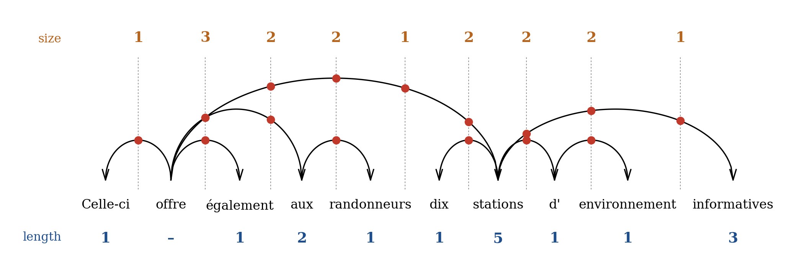
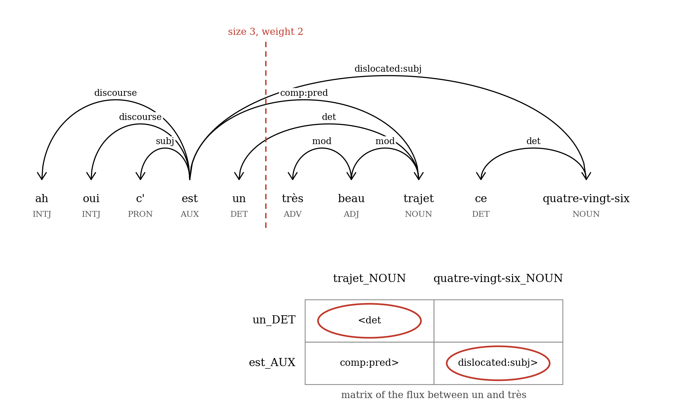
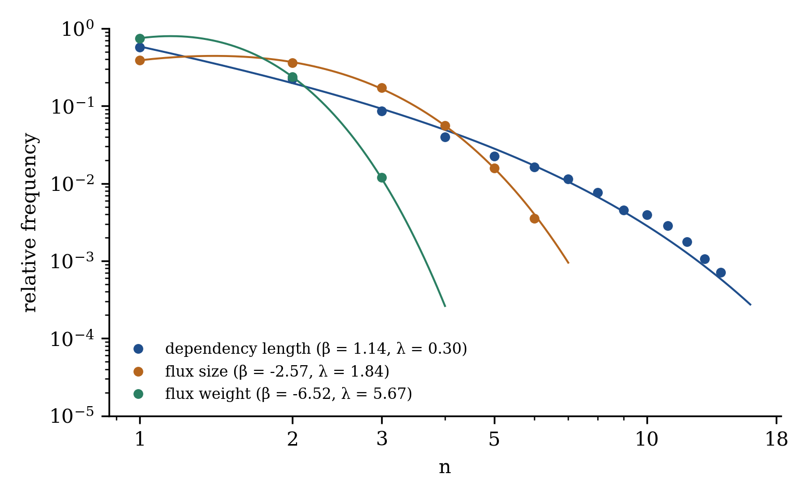
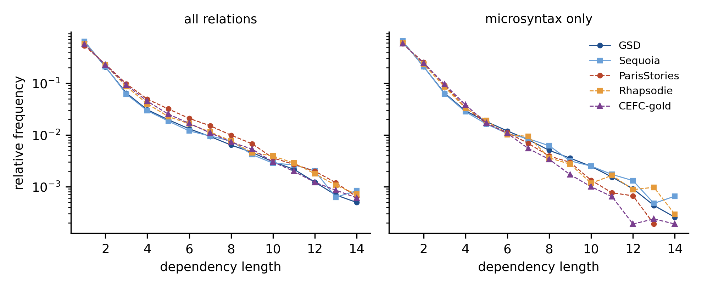
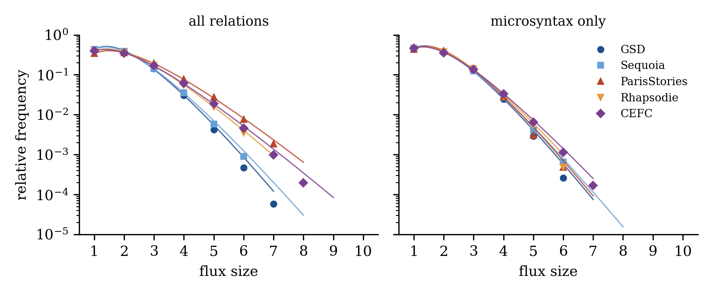
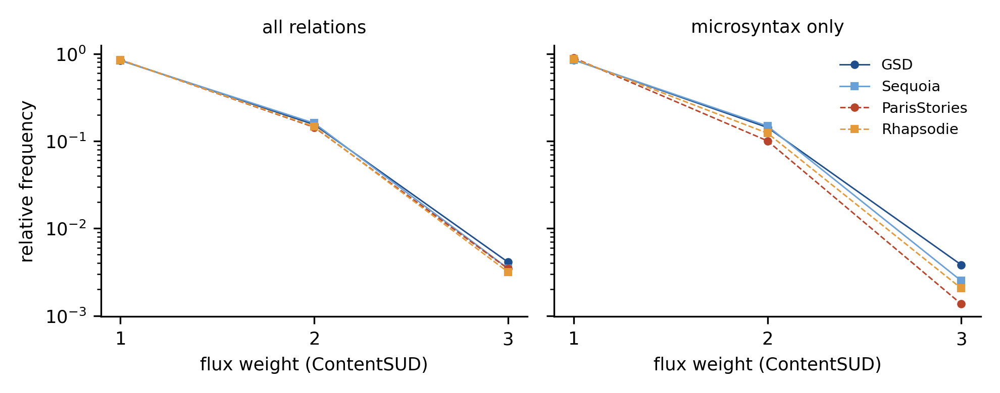

::: {.authors}
Sylvain Kahane^[Modyco (CNRS), Université Paris Nanterre; IUF – Institut Universitaire de France.] and Kim Gerdes^[LISN (CNRS), Université Paris-Saclay.]
:::

::: {.abstract}
**Abstract:** Sentence length, a common measure of complexity (François 2011), cannot be used to compare speech and writing, because the maximal syntactic unit of speech is difficult to define (Pietrandrea et al. 2014). Mean dependency length (Liu 2008; Ouyang et al. 2022) and the proportion of dependencies longer than a threshold (Niu et al. 2023) have been proposed instead. We introduce related measures based on the dependency flux. The flux at a point of a sentence is the set of syntactic dependencies that link a word before this point to a word after it. We first consider the size of the flux: its mean is equal to the mean dependency length, but its large values are much more constrained. We then consider finer measures of the composition of the flux, which could not be defined in terms of dependency length. On treebanks of spoken and written French, we show that the syntactic complexity of speech is as high as that of writing when only microsyntax is considered, that it lies in different places (in verbal rather than nominal constructions), and that it is even higher when the macrosyntactic relations, much more frequent in speech, are taken into account (Blanche-Benveniste 1990).
:::

::: {.abstract}
**Key words:** dependency flux, dependency length, syntactic complexity, spoken French, macrosyntax, Surface-Syntactic Universal Dependencies
:::

::: {.abstract}
**Rezumat:** Lungimea propozițiilor, o măsură obișnuită a complexității (François 2011), nu poate fi folosită pentru a compara oralul și scrisul, deoarece unitatea sintactică maximală a oralului este greu de definit (Pietrandrea et al. 2014). În locul ei au fost propuse lungimea medie a dependențelor (Liu 2008; Ouyang et al. 2022) și proporția dependențelor care depășesc un anumit prag (Niu et al. 2023). Introducem măsuri înrudite, bazate pe fluxul de dependențe. Fluxul într-un punct al unei propoziții este mulțimea dependențelor sintactice care leagă un cuvânt aflat înaintea acestui punct de un cuvânt aflat după el. Considerăm mai întâi mărimea fluxului: media ei este egală cu lungimea medie a dependențelor, dar valorile ei mari sunt mult mai constrânse. Considerăm apoi măsuri mai fine ale compoziției fluxului, care nu ar putea fi definite în termeni de lungime a dependențelor. Pe corpusuri adnotate de franceză vorbită și scrisă, arătăm că complexitatea sintactică a oralului este la fel de mare ca a scrisului atunci când se ia în considerare doar microsintaxa, că ea se află în alte locuri (în construcțiile verbale mai degrabă decât în cele nominale) și că este chiar mai mare atunci când se iau în considerare relațiile macrosintactice, mult mai frecvente în oral (Blanche-Benveniste 1990).
:::

::: {.abstract}
**Cuvinte-cheie:** flux de dependențe, lungimea dependențelor, complexitate sintactică, franceza vorbită, macrosintaxă, Surface-Syntactic Universal Dependencies
:::

# 1. Introduction

Speech is often described as "simple", made of short juxtaposed utterances, and writing as "complex", rich in subordination and extended noun phrases. For written texts, sentence length is indeed a good measure of complexity: it is one of the best predictors of readability and of the difficulty of texts for learners (François 2011). But it cannot be used to compare speech and writing, because the units of speech are not graphic sentences, and they are segmented on other criteria (Blanche-Benveniste 1990; Pietrandrea et al. 2014). Speech also has its own structures (dislocations, discourse markers, repetitions, reformulations), which cannot be reduced to simplified writing.

By complexity, we mean a property of utterances related to the difficulty of processing them: an utterance is more complex if it is more difficult to produce or to understand. A measure that does not depend on the delimitation of sentences is the length of syntactic dependencies, the distance between two words linked by a dependency. Long dependencies are assumed to be more costly, because a word that is waiting for its governor or its dependent must be kept in memory until it arrives (Gibson 1998, 2000), and mean dependency length has been used as a measure of comprehension difficulty (Liu 2008) and of the proficiency of second-language writers (Ouyang et al. 2022). Other studies use the proportion of short and long dependencies, below or above a threshold (Niu et al. 2023).

We introduce measures related to dependency length, based on the dependency flux (Kahane 2001; Botalla 2014; Kahane et al. 2017; Yan 2021). The flux at a position between two words is the set of dependencies that link a word before this position to a word after it. Figure 1 gives an example, an utterance of ten words from the Rhapsodie corpus, *ah oui c'est un très beau trajet ce quatre-vingt-six* 'oh yes, it's a very nice route, this 86' (the 86 is a bus line). Between *trajet* and *ce*, a single dependency crosses the position, the one linking the verb *est* 'is' to its right-dislocated subject *quatre-vingt-six*: the flux has size 1. Between *très* 'very' and *beau* 'nice', four dependencies cross the position: the verb *est* waits for its predicative complement *trajet* and for its dislocated subject, the determiner *un* 'a' waits for the noun *trajet*, and the adverb *très* waits for the adjective *beau*: the flux has size 4. Three of these dependencies share no word (*est*–*quatre-vingt-six*, *un*–*trajet*, *très*–*beau*): three constructions are open at the same time, and the flux has *weight* 3. Beyond size and weight, we will look at the *composition* of the flux: which dependencies it contains and which of them are kept open together. We compute all these measures twice, once with all the relations and once with the microsyntactic relations only, leaving out the macrosyntactic ones, such as discourse markers and dislocations (Blanche-Benveniste 1990).

{width=16cm}

We compare two written and three spoken treebanks of French. The classical view does not hold: the syntax of writing is not more complex than that of speech. At equal sentence length, spoken dependencies are a little longer on average, but speech has fewer very long dependencies in microsyntax. Its flux is larger when all the relations are counted, and the surplus comes from macrosyntax. In microsyntax, the flux has the same size and the same weight in the two modalities, but not the same composition: written French keeps nominal constructions open together, spoken French verbal ones.

We work on corpora and describe distributions. We do not do psycholinguistics, but we propose a possible interpretation of our results in the light of psycholinguistic work, and we keep it apart from the results (section 5). Section 2 introduces the measures, section 3 the data, section 4 gives the results, section 5 discusses them and section 6 concludes.

# 2. From dependency length to dependency flux

## 2.1. Dependency length

The length of a dependency is the distance, in words, between a governor and its dependent: 1 for two adjacent words. Many studies have shown that languages tend to minimize this length (Hudson 1995; Gibson 1998; Ferrer-i-Cancho 2004; Liu 2008; Futrell, Mahowald & Gibson 2015). This tendency, dependency length minimization (DLM), explains several properties of word order (Temperley 2008), for instance the preference for placing short complements before long ones, already formulated by Buffier (1709) and rediscovered as *heavy constituent shift* (Ross 1967) or *domain minimization* (Hawkins 1994, 2004). In (1a), a sentence of the GSD corpus, the verb *offre* is the second word and the heads of its three complements, *également*, *aux* and *stations*, are the third, fourth and seventh words: the sum of the three distances is 1 + 2 + 5 = 8. In the reverse order (1b), it is 2 + 6 + 8 = 16, while the other dependencies keep their length.

::: {.ex}
\(1\) a. Celle-ci offre également aux randonneurs dix stations d'environnement informatives.\
  'This one also offers hikers ten informative environmental stations.'\
  b. Celle-ci offre dix stations d'environnement informatives aux randonneurs également.
:::

That languages minimize dependency length is one thing; that dependency length measures the complexity of a sentence is another. Liu (2008) proposed the mean dependency distance as a metric of comprehension difficulty, and Ouyang et al. (2022) use it to assess the writing of learners. Niu et al. (2023) compare languages by the proportion of adjacent dependencies (length 1), of short dependencies (length 4 or less) and of long dependencies (longer than 7). The justification is the same in all these studies: the further apart two related words are, the heavier the load on working memory, either because information decays with time or because memory has a limited capacity (Niu et al. 2023).

DLM also accounts for the difficulty of center embedding. Chomsky (1957: 21) introduced this notion to show that English is not a finite-state language: relative clauses can in principle be embedded one inside the other without limit. In practice they cannot, and three levels already make sentences incomprehensible (Chomsky & Miller 1963; Reich 1969):

::: {.ex}
\(2\) The rat that the cat that the dog worried killed ate the malt.
:::

The literal translation of (2) into French (3a) is just as incomprehensible, whereas passivization and subject inversion express the same content without center embedding (3b):

::: {.ex}
\(3\) a. Le rat que le chat que le chien inquiétait a tué mangeait le malt.\
  b. Le malt était mangé par le rat qui a été tué par le chat qu'inquiétait le chien.\
  'The malt was eaten by the rat that was killed by the cat that the dog worried.'
:::

The dependencies are much longer in (3a) than in (3b): *rat* and *mangeait* 'ate', the second and twelfth words of (3a), are ten words apart, against three in (3b). But DLM does not explain why center embedding becomes unacceptable beyond two levels, while long dependencies remain possible elsewhere. This is what the flux can address.

## 2.2. The flux and its size

The flux at a position between two words is the *set* of dependencies that link a word before this position to a word after it, the dependencies that cross the position. Its *size* is the number of these dependencies. Size is thus a count, not a continuous magnitude. Figure 2 shows how flux size and dependency length are related. Each red dot is the intersection of a dependency and a position between two words. The dots of a column add up to the size of the flux at this position; the dots of a dependency add up to its length. The two totals, the sum of the flux sizes and the sum of the dependency lengths of the sentence, are therefore equal. Since a sentence of *n* words has *n* − 1 dependencies and *n* − 1 positions between words, the mean dependency length is equal to the mean flux size. Minimizing dependency length amounts to minimizing flux size.

{width=14cm}

The two formulations do not have the same interpretation. For DLM, a long dependency is costly because information decays in memory while the second word is awaited (Gibson 1998). For the minimization of flux size, what is costly is the number of dependencies that must be handled at the same time. We come back to these interpretations in section 5.

## 2.3. Flux weight

The flux has a structure. Dependencies that share a word at one of their ends form a *bouquet* and can be grouped: a verb and its pending complements make only one unit to be kept open. Dependencies that share no word are *disjoint* and must be kept apart; it is they that characterize center embedding. In (3a), after *chien* 'dog', three subjects wait for their respective verbs (*rat*, *chat* 'cat' and *chien*): these are three disjoint dependencies. The *weight* of the flux is the largest number of pairwise disjoint dependencies that it contains (Kahane et al. 2017).

Botalla (2014) represents the flux at a position as a matrix whose rows are the words on the left, whose columns are the words on the right, and whose cells are the dependencies. The weight is the largest number of cells that can be chosen without taking the same row or the same column twice. Figure 3 cuts the utterance of Figure 1 between *un* and *très*. Three dependencies cross the position (*est*–*trajet*, *est*–*quatre-vingt-six*, *un*–*trajet*): the flux has size 3. But the first two share *est*, and the first and the third share *trajet*, so that at most two of them share no word: the weight is 2. In the matrix, the two cells chosen are neither in the same row nor in the same column.

{width=14cm}

## 2.4. The composition of the flux

Size and weight do not tell which dependencies make up the flux. In Botalla's matrix, each cell is a dependency with a governor of a given category and a relation of a given type, so that the matrix also shows which kinds of dependencies are kept open together. Two disjoint dependencies of the same kind should be the most difficult to handle at the same time, like the three pending subjects of (2) and (3a). We therefore look, at each position, at the pairs of disjoint dependencies of the flux: the category of their two governors, noun or verb, and their two relations, subject, object, oblique or modifier. We also look at the direction of the pending dependencies (does a governor wait for its dependent, or a dependent for its governor?) and at the share of the flux that bouquets absorb. None of these measures can be defined in terms of dependency length, which is a property of each dependency taken alone.

## 2.5. Distributions and the saturation index

The *distribution* of a measure says how often each of its values occurs. Let *p*(*n*) be the relative frequency of the value *n*: the share of dependencies of length *n*, or the share of positions where the flux has a size or a weight *n*. The distributions of flux size and flux weight decrease much faster than that of dependency length. Figure 4 shows the three distributions in the Rhapsodie corpus, for the sentences of 10 to 19 words. We describe them by a power law with an exponential cut-off, *p*(*n*) ∝ *n*^−β^ e^−λ*n*^, estimated by maximum likelihood.^[The estimation maximizes the likelihood of the observed counts (Nelder–Mead algorithm of the SciPy library); the computations were programmed with the assistant Claude (Anthropic) and can be checked on the companion site [https://typometrics.github.io/flux-oral-ecrit/].]

The parameter λ measures how fast large values become rare: far from the most frequent value, each increase of *n* by one unit divides *p*(*n*) by about e^λ^. In the study of complex systems, such a cut-off signals that a resource is limited and that the system saturates as it approaches the limit (Mandelbrot 1953; Amaral et al. 2000); we therefore call λ the *saturation index* of the measure. The parameter β describes the beginning of the curve: with β > 0, the distribution decreases from its first value on, as dependency length does; with β < 0, it first rises to a most frequent value and then decreases, as flux size and weight do. For dependency length in Rhapsodie, β is 1.1 and λ is 0.30: the distribution is close to a power law and saturates only slowly, which leaves room for long dependencies (Petrini & Ferrer-i-Cancho 2025). For flux size, β is negative (−2.6): the distribution rises to a most frequent value of 2 before decreasing, and λ (1.85) describes the decrease; a size of 5 is already twenty-five times rarer than a size of 2. For weight, the saturation is even sharper (λ = 5.7): a weight of 3 is twenty times rarer than a weight of 2, and a weight of 4 a hundred times rarer than a weight of 3.

{width=13cm}

The two parameters also summarize the proportions used by Niu et al. (2023): β governs the share of short dependencies, λ that of long ones, without choosing a threshold. In our corpora, the fitted curves reproduce the shares of dependencies of length 1, of length 2 or less and of length 4 or less to within two points, and the share of dependencies longer than 7 to within half a point (section 4.1).

# 3. Data

## 3.1. Corpora

We use four treebanks annotated in Surface-Syntactic Universal Dependencies (SUD; Gerdes et al. 2018), in their latest version (v2.19, November 2026), and the CEFC-gold corpus of the Orféo project (Benzitoun, Debaisieux & Deulofeu 2016; Kahane & Gerdes 2020), annotated in a scheme very close to SUD. The two written corpora are GSD (Guillaume, de Marneffe & Perrier 2019), a collection of web texts made by Google, whose genres are not documented, and Sequoia (Candito & Seddah 2012), made of newspaper articles from *L'Est républicain*, medical leaflets, debates of the European Parliament and Wikipedia articles. The three spoken corpora are ParisStories, a corpus of solicited personal narratives; Rhapsodie (Lacheret-Dujour, Kahane & Pietrandrea 2019), which covers various genres (interviews, descriptions, discussions, speeches); and CEFC-gold, which gathers conversations, interviews and service interactions from four corpora described in Benzitoun, Debaisieux & Deulofeu (2016): TCOF (*Traitement de corpus oraux en français*), CLAPI (*Corpus de langues parlées en interaction*), Valibel (Belgian French) and C-ORAL-ROM (spontaneous speech in Romance languages). Punctuation is removed. We only keep the sentences of at least three words: with two words, the flux always has size 1.

| Corpus | Modality | Sentences | Words | Mean length | Macrosyntax | of which `mod:periph` | Repetitions | Sentences beginning with a conjunction |
|---|---|---:|---:|---:|---:|---:|---:|---:|
| GSD | written | 18,456 | 344,730 | 18.7 | 1.7% | 1.6% | 0% | 7.4% |
| Sequoia | written | 3,185 | 60,084 | 18.9 | 1.9% | 1.5% | 0% | 9.6% |
| ParisStories | spoken | 2,594 | 33,793 | 13.0 | 14.0% | 3.1% | 2.3% | 34.5% |
| Rhapsodie | spoken | 2,699 | 34,099 | 12.6 | 9.0% | 2.5% | 2.6% | 22.2% |
| CEFC-gold | spoken | 17,638 | 163,047 | 9.2 | 12.3% | 3.5% | 1.3% | 18.6% |

: Table 1: The corpora (sentences of at least three words, punctuation removed; GSD and Sequoia after segmentation). Macrosyntax (including the preposed modifiers, `mod:periph`, section 3.3) and repetitions (`reparandum`, section 3.4): share of the dependencies; last column: share of the sentences whose first word is a coordinating conjunction.

One fifth to one third of the spoken sentences begin with a coordinating conjunction (*et* 'and', *mais* 'but'…), against less than one in ten in writing, even after our segmentation; we do not distinguish here conjunctions from connectives. Macrosyntactic relations make up 9 to 14% of the dependencies of speech and less than 2% of those of writing, where they are almost only preposed modifiers. Half of the discourse markers are hesitations: *euh* 'uh' accounts for 49% of the `discourse` dependencies of ParisStories and 53% of those of Rhapsodie. Our corpora do not cover the whole continuum of Koch & Oesterreicher (2001), from the communicative immediacy of conversation to the communicative distance of elaborate texts: we have neither literary texts, whose sentences are often long, nor writing from social networks, closer to speech.

## 3.2. Sentences

The maximal units of the spoken treebanks are *illocutionary units*, segments that can form an autonomous speech act, such as an assertion or a question (Benzitoun et al. 2010; Pietrandrea et al. 2014). The criterion is pragmatic, but its application is syntactic: two coordinated main clauses form two illocutionary units in speech, whereas they form one sentence in writing if no full stop separates them. To compare like with like, we segment the written corpora as the spoken ones are segmented: we cut the coordinations and parataxes of clauses that depend on the root, except when the subject is shared, and only when the two parts remain continuous. This segmentation takes GSD from 16,328 sentences of 21.2 words on average to 18,456 sentences of 18.7 words, and Sequoia from 2,857 sentences of 21.1 words to 3,185 sentences of 18.9 words (Table 1). In what follows, we use the term *sentence* for the maximal unit, in speech as well as in the re-segmented writing.

All the measures grow with the length of the sentence: a longer sentence allows longer dependencies and larger fluxes (Ferrer-i-Cancho & Liu 2014; Jiang & Liu 2015). We therefore compare the corpora at equal sentence length, measured in words: mainly the sentences of 10 to 19 words, and also those of 10 to 29 words.

## 3.3. Microsyntax and macrosyntax

Following Blanche-Benveniste (1990), we distinguish *microsyntax*, the relations of government within a construction (a verb and its subject, its complements and its modifiers, a noun and its determiner), from *macrosyntax*, the relations that link elements to a construction without being governed by it. In the SUD annotation, the macrosyntactic relations are the discourse markers (`discourse`), the dislocations (`dislocated`), the vocatives (`vocative`), and the parentheticals and other paratactic clauses, juxtaposed without a conjunction (`parataxis`).^[In CEFC-gold, the corresponding relations are `dm` (discourse marker), `parenth` (parentheticals) and `periph` (peripheral elements, that is, dislocated elements, vocatives, and also modifiers outside the verb phrase).]

These are not the only elements that escape the government of the verb. In the approach of Blanche-Benveniste (1990), taken up by Benzitoun et al. (2010), the elements placed before the subject, such as *quand tu mets la farine* 'when you put in the flour' and *au final* 'in the end' in *en fait quand tu mets la farine au final ça se décolle* 'actually, when you put in the flour, in the end it comes off' (ParisStories), are islands that do not belong to the core of the verbal construction. In SUD, such elements are attached to the verb by the relation of modifiers, `mod`, or by `udep`, which leaves open the choice between a complement and a modifier; this is why we speak of *preposed modifiers*. We treat them as macrosyntactic too: every modifier (`mod`, `udep`) of a verb placed before the subject of this verb is relabeled `mod:periph`, in speech as in writing. These preposed modifiers make up 1.5 to 1.6% of the dependencies of writing and 2.5 to 3.5% of those of speech (Table 1).

We compute all the measures twice: on the sentences with all their relations, and on their *illocutionary components* (Benzitoun et al. 2010), the pieces obtained by cutting all the macrosyntactic dependencies, `mod:periph` included, which contain only microsyntactic dependencies. A segment cut off in this way can be long, like a parenthetical or a dislocated element: if it has at least three words, it becomes a component of its own, measured and classified according to its own length; if it has fewer than three words, it is simply removed. Thus, in the utterance of Figure 1, *ah*, *oui* and *ce quatre-vingt-six* are removed, and what remains is *c'est un très beau trajet*, six words whose flux never exceeds 3.

## 3.4. Repetitions and reformulations

Repetitions (`reparandum`) and reformulations (`conj:reform`) are a different case: they are microsyntactic relations, but specific to speech. A repetition is a segment that is abandoned and then taken up again, identically or nearly so, like the first *c'était* 'it was' of Figure 5; a reformulation is a segment replaced by another one that takes the same syntactic place without cancelling it, like *super spacieux* 'really spacious', which reformulates *super bien* 'really nice'. In SUD, the repetition depends on the segment that replaces it, by the relation `reparandum`, and the reformulation is a relation between two conjuncts, the second of which reformulates the first (`conj:reform`). Listeners remember a repaired error well only when they have acted on it (Lakhani & Nozari 2022), and Blanche-Benveniste (1990) describes reformulations as a piling up of formulations that the listener combines into one. We therefore make the hypothesis that repetitions are quickly erased from working memory, whereas reformulations are processed. We also give the measures without the repetitions, removed like the macrosyntactic segments.

{width=14cm}

## 3.5. Trees: SUD and ContentSUD

In SUD, function words (prepositions, auxiliaries, subordinating conjunctions) are the heads of their phrases, because they determine the distribution of the phrase: *de la maison* 'of the house' is headed by the preposition *de*. This gives shorter dependencies than UD, where the content word is the head, and more regular distributions of lengths (Petrini & Ferrer-i-Cancho 2025). We use SUD for dependency length and flux size.

For weight and for the composition of the flux, we use the tree of the content words, ContentSUD: the function words (determiners, prepositions, auxiliaries, copulas, conjunctions) are removed, and the dependencies link the content words directly, with the SUD relation that the function word had.^[UD treats function words as leaves and gives priority to the relations between content words; ContentSUD keeps SUD's chains of conjuncts and SUD's relations. CEFC-gold, whose annotation does not distinguish the relations needed, has no ContentSUD tree.] A content word and its function words form what Tesnière (1959) called a *nucleus*: one unit, not several, and we suppose that it is the relations between nuclei that create complexity for the listener. In *le chat de la voisine* 'the neighbor's cat', for instance, ContentSUD keeps a single dependency between *chat* 'cat' and *voisine* 'neighbor'.

# 4. Results

## 4.1. Dependency length

Table 2 gives the shares of short and long dependencies in the sentences of 10 to 19 words. Spoken French has fewer short dependencies than written French: 53 to 58% of its dependencies link adjacent words, against 64% in writing. With all relations, it has about as many long dependencies, longer than 7 words (2.1 to 2.8% against 1.9 and 2.2%). In microsyntax, the long dependencies of speech become rarer than those of writing (0.7 to 1.1% against 1.4 and 1.7%). The distribution of speech is thus more concentrated: fewer adjacent words, fewer very distant ones, more lengths of 2 to 4 (Figure 6).

| Corpus | Length 1 | Length ≤ 2 | Length > 7 | Mean | β | λ |
|---|---:|---:|---:|---:|---:|---:|
| GSD | 63.9 / 64.6% | 84.4 / 85.4% | 1.9 / 1.4% | 1.79 / 1.73 | 1.52 / 1.43 | 0.24 / 0.29 |
| Sequoia | 63.9 / 64.9% | 84.7 / 85.8% | 2.2 / 1.7% | 1.81 / 1.73 | 1.64 / 1.53 | 0.19 / 0.26 |
| ParisStories | 52.8 / 58.0% | 75.9 / 83.1% | 2.8 / 1.0% | 2.13 / 1.78 | 0.91 / 0.58 | 0.32 / 0.59 |
| Rhapsodie | 57.6 / 60.0% | 80.1 / 83.2% | 2.3 / 1.1% | 1.96 / 1.78 | 1.14 / 0.95 | 0.30 / 0.44 |
| CEFC-gold | 56.5 / 58.2% | 79.0 / 82.6% | 2.1 / 0.7% | 1.97 / 1.76 | 0.99 / 0.46 | 0.35 / 0.65 |

: Table 2: Dependency length, sentences of 10 to 19 words, SUD: all relations / microsyntax only. Shares of the dependencies of length 1, of 2 or less and of more than 7; parameters of the fitted distribution. Standard errors of λ estimated by resampling the sentences: 0.005 to 0.025.

{width=14cm}

The two parameters of the fitted curves summarize these shares. A smaller β means fewer dependencies of length 1, and a larger λ fewer long dependencies: speech has the smaller β and, in microsyntax, the larger λ in all three corpora. The fitted curves reproduce the shares of Table 2 to within two points for short dependencies and to within half a point for long ones. The results are the same for the sentences of 10 to 29 words.

## 4.2. Flux size

Table 3 gives the size of the flux for the sentences of 10 to 19 words. With all relations, the three spoken corpora have a larger flux than the two written ones (2.0 to 2.1 dependencies crossing a position on average, against 1.8) and a clearly lower saturation index: large fluxes are more frequent. Since mean flux size equals mean dependency length, this is the same difference as in the column "Mean" of Table 2. For microsyntax only, the five corpora come together: the mean flux of speech exceeds that of writing by only 0.03 to 0.05, and the saturation index of ParisStories and Rhapsodie joins that of GSD and Sequoia; only that of CEFC-gold remains clearly lower.^[If we remove the discourse markers, dislocations, vocatives and parataxes but keep the preposed modifiers, the surplus of speech decreases by only two thirds (1.89 to 1.91 against 1.79 and 1.80).] Figure 7 shows the two situations: with macrosyntax, the curves of speech move away from those of writing from a flux of size 4 on; for microsyntax only, the five corpora follow practically the same curve. The result is the same for the sentences of 10 to 29 words, and removing the repetitions as well changes almost nothing: a repetition is short, and removing it removes as many positions as dependencies.

| Corpus | Sentences | Mean flux size | λ |
|---|---:|---:|---:|
| GSD | 7,733 / 8,645 | 1.79 / 1.73 | 2.50 / 2.59 |
| Sequoia | 1,097 / 1,299 | 1.81 / 1.73 | 2.32 / 2.42 |
| ParisStories | 989 / 858 | 2.13 / 1.78 | 1.61 / 2.59 |
| Rhapsodie | 902 / 832 | 1.96 / 1.78 | 1.84 / 2.39 |
| CEFC-gold | 4,599 / 3,547 | 1.97 / 1.76 | 1.68 / 2.15 |

: Table 3: Flux size, sentences of 10 to 19 words, SUD: all relations / microsyntax only. Mean flux size per position between two words; λ: saturation index. Standard errors estimated by resampling the sentences: 0.002 to 0.017 for the means, 0.02 to 0.07 for λ.

{width=14cm}

Dependency length and flux size thus do not say the same thing. For long dependencies, speech would be simpler than writing in microsyntax, with fewer dependencies longer than 7 words. For flux size, it is as complex in microsyntax and more complex with all relations, because more dependencies are open at the same time.

## 4.3. Flux weight

The weight of the flux, computed on the content words (ContentSUD), is practically the same in the four corpora (Figure 8; Table 4): its mean is between 1.15 and 1.17 per position with all relations, for the sentences of 10 to 19 words, and the weight reaches 3 in about 2% of the sentences of each corpus. For microsyntax only, the weight of speech is even a little lower (1.10 and 1.13 against 1.15), and its saturation index lies between those of the two written corpora. The largest weight reached in a sentence is remarkably low. Over all the sentences, whatever their length, it never exceeds 5 (one sentence in GSD, one in Sequoia), and a weight of 4 is reached in less than 0.6% of the sentences of each corpus.^[These sentences are listed on the companion site for checking.] The limitation of center embedding is the same in speech and in writing.

{width=14cm}

## 4.4. The composition of the flux

The flux of speech and that of writing have the same size in microsyntax and the same weight, but they are not made of the same dependencies. We look first at the pairs of disjoint dependencies, at each position, according to the category of their two governors (ContentSUD, sentences of 10 to 19 words, all relations; Table 4). In (4), from GSD, after *grande* 'high', two nouns wait for their dependents: the noun *travail* 'work' will be modified by *exécuté* 'carried out', and the noun *qualité* 'quality' is waited for by the adjective *grande*. In (5), from Rhapsodie, after *qui* 'who', two subjects wait for their verbs, two verbal governors: *ceux* 'those' waits for *sont* 'are', and *qui* for *ont* 'have'. The indices mark the pairs of words linked by a pending dependency, and | the position.

::: {.ex}
\(4\) Travail~1~ de très grande~2~ | qualité~2~ exécuté~1~ par un imprimeur artisan passionné.\
  'Work of very high quality carried out by a passionate craftsman printer.'\
(5) ceux~1~ qui~2~ | ont~2~ des enfants sont~1~ à peu près autour des trente ans\
  'those who have children are about thirty'
:::

Two disjoint dependencies with nominal governors are found at 1.6% (GSD) and 3.0% (Sequoia) of the positions of writing, but at only 0.4% (ParisStories) and 0.9% (Rhapsodie) of those of speech. Two disjoint dependencies with verbal governors are found at 2.1 and 2.4% of the positions of writing, and at 5.2 and 3.7% of those of speech. Writing keeps nominal constructions open together, speech verbal ones.

In all the corpora, pairs of governors of the same category are rarer than mixed pairs. If the categories of the two governors were independent, with shares *p* of nouns and *q* of verbs, one would expect *p*² pairs of nouns, *q*² pairs of verbs and 2*pq* mixed pairs, that is, twice the geometric mean of the first two. The observed mixed pairs exceed this expectation by a factor of 1.7 (Sequoia) to 3.1 (GSD). Part of this excess is mechanical: two dependencies that share their governor are not disjoint, and such pairs necessarily have governors of the same category. To set this effect aside, we put the words of each sentence in a random order that keeps its tree and its total dependency length. In these random orders, the factor is lower in all four corpora (1.4 to 2.4). Real sentences thus avoid disjoint dependencies of the same kind beyond what their trees impose, which goes in the direction of a particular difficulty in handling two relations of the same type at the same time.

The relations show the same tendency, with small numbers. Two pending objects are rare everywhere (5 to 24 positions per corpus) and 1.4 to 4.3 times rarer than in the random orders. Two pending subjects, as in (5), are 2 to 6 times rarer than in the random orders in speech, but hardly in writing. Two pending modifiers, on the contrary, are not avoided. A subject, an object and an oblique complement that are pairwise disjoint never occur in speech, and occur in only two written sentences, both from GSD: *Autant de questions auxquelles le groupe d'amis réuni autour d'Ethan va tenter de répondre* 'So many questions that the group of friends gathered around Ethan will try to answer', and *Si ce que je dis est vrai, que ces temples s'écroulent* 'If what I say is true, may these temples collapse'.

| | GSD | Sequoia | ParisStories | Rhapsodie |
|---|---:|---:|---:|---:|
| Mean weight | 1.16 / 1.15 | 1.17 / 1.15 | 1.15 / 1.10 | 1.15 / 1.13 |
| λ weight | 6.4 / 6.2 | 6.9 / 7.4 | 6.5 / 7.3 | 6.8 / 7.1 |
| Sentences reaching weight 3 | 2.1 / 1.9% | 2.0 / 1.5% | 2.2 / 0.9% | 2.3 / 1.3% |
| Positions with an NN pair | 1.6 / 1.9% | 3.0 / 3.2% | 0.4 / 0.5% | 0.9 / 1.2% |
| Positions with a VV pair | 2.1 / 1.8% | 2.4 / 2.1% | 5.2 / 2.3% | 3.7 / 2.5% |
| Mixed-pair factor, observed | 3.1 / 2.7 | 1.7 / 1.6 | 2.1 / 2.4 | 2.1 / 1.8 |
| Mixed-pair factor, random orders | 2.4 / 2.1 | 1.5 / 1.5 | 1.4 / 1.4 | 1.6 / 1.5 |
| Head-final pending dependencies | 0.64 / 0.52 | 0.65 / 0.52 | 1.09 / 0.65 | 0.88 / 0.61 |
| Share of the flux in bouquets | 0.31 / 0.29 | 0.32 / 0.30 | 0.45 / 0.35 | 0.38 / 0.33 |

: Table 4: The composition of the flux, sentences of 10 to 19 words: all relations / microsyntax only. Weight on ContentSUD; positions with two disjoint dependencies whose governors are two nouns (NN) or two verbs (VV); mixed-pair factor NV / 2√(NN·VV), observed and in random orders of the same trees with the same total length; pending dependencies per position whose dependent comes first (head-final) on SUD; share of the flux absorbed by bouquets, 1 − weight/size, on ContentSUD.

The direction of the pending dependencies also differs. A pending dependency is head-initial when the governor comes first and waits for its dependent, as a verb waits for its object; it is head-final when the dependent comes first and waits for its governor, as a subject waits for its verb. The head-initial dependencies are about as numerous in all corpora (1.0 to 1.2 per position). The head-final ones are much more numerous in speech with all relations (0.88 to 1.09 per position, and 0.94 in CEFC-gold, against 0.64 and 0.65 in writing): the surplus of the spoken flux is made of elements placed before their governor, waiting for it. In microsyntax, the difference shrinks (0.61 to 0.65 against 0.52).

These elements form bouquets. Figure 9 shows an utterance from ParisStories where the discourse markers *euh*, *bon* 'well' and *bah*, the dislocated subject *moi* 'me' and the preposed modifier *parfois* 'sometimes' are attached to the verb *fais* 'do', and *hein* to the main verb *sais* 'know': they make the size of the flux rise up to 8, whereas the microsyntactic flux does not exceed 3. In speech, bouquets absorb 38 to 45% of the flux with all relations, against 31 to 32% in writing (Table 4): the elements waiting for the same verb can be kept together.

{width=16cm}

# 5. Discussion

## 5.1. The results

At equal sentence length, spoken French has slightly longer dependencies on average than written French, fewer dependencies between adjacent words, and, in microsyntax, fewer very long dependencies. Its flux is larger with all relations, and its saturation index lower. This surplus is made of macrosyntactic relations: discourse markers, dislocated elements, parentheticals and preposed modifiers, twice as frequent in speech. These relations almost all start from the main verb and form bouquets, so that they increase the size of the flux without increasing its weight. In microsyntax, the mean flux size of speech exceeds that of writing only slightly, its saturation index is the same (except in CEFC-gold), its weight is a little lower, and the distribution of weight on content words is the same in the four corpora. What differs is the composition of the flux: pairs of disjoint dependencies with nominal governors in writing, with verbal governors in speech, and more dependents waiting for their governor in speech.

These results depend on annotation and processing choices. In SUD as in UD, discourse markers and dislocated elements that bear on the sentence are attached to the main verb, and another attachment would change the size of the flux. The correspondence between the relations of CEFC-gold and those of SUD remains approximate, which probably explains why its saturation index stays apart. The results also depend on the segmentation of the spoken corpora, which differs between the three corpora. Finally, our spoken corpora are small, so that the differences of saturation index between two spoken corpora are not all significant.

## 5.2. An interpretation

We now propose an interpretation, which goes beyond what corpora can show. Dependency length and flux size have often been related to working memory, either because information decays while a dependency is open (Gibson 1998) or because memory has a limited capacity (Miller 1956; Cowan 2001). In this view, the saturation index of flux size, and above all of flux weight, would measure the pressure that working memory exerts on production: a speaker can accumulate pending dependencies, but each additional one is paid for at an exponential rate.^[On the exponential cost of new items in working memory, see Peterson & Peterson (1959) or Barrouillet, Portrat & Camos (2011).] We suppose that the constraints we observe are those of working memory in syntactic processing, after the perception of the signal: the processing of the auditory or visual signal has its own constraints, which could also differ between speech and writing, but they are outside the scope of this study. Nor do we know whether these constraints act on the speaker, who could not produce more complex structures, or on the model that the speaker has of the listener, whom the speaker wants to be understood by: the question deserves to be asked, and we leave it open.

Chafe (1982) observed that speech is produced in short idea units of about six words, against about eleven in writing, and the reader of a written text can go back: 10 to 15% of the eye movements in reading are regressions (Rayner 1998). This could explain why speech has fewer very long dependencies in microsyntax. It does not explain why it has fewer adjacent dependencies, nor why its flux is not smaller. According to Christiansen & Chater (2016), language processing involves several levels, each of which must deal with its input immediately, before it is overwritten by the next one: sounds are grouped into words, words into phrases, phrases into larger units, and what has not been grouped at one level is lost for the next. And syntactic processing may rely on a memory resource of its own, distinct from the verbal working memory that holds words (Caplan & Waters 1999). Even with spans of different lengths, the two modalities can thus have fluxes of the same size and weight.

The same idea of several levels can account for the difference between microsyntax and macrosyntax: macrosyntax is not subject to the same kind of pressure as microsyntax, because the two are not processed at the same level. The flux supports in this way the choice, following Blanche-Benveniste (1990), to treat the preposed modifiers as macrosyntactic. If they are kept in microsyntax, speech keeps a surplus of flux and a lower saturation index; if they are removed, in speech as in writing, the two modalities have the same saturation index. The flux thus gives a quantitative criterion for the boundary between microsyntax and macrosyntax. Finally, the rarity of pairs of disjoint dependencies of the same kind fits with interference-based models of memory, in which two elements of the same kind compete when they have to be retrieved (Gordon, Hendrick & Johnson 2001; Lewis & Vasishth 2005).

# 6. Conclusion

Measured by the size and the weight of the dependency flux rather than by the length of sentences or dependencies, the syntactic complexity of speech is not lower than that of writing. But speech does not put its flux in the same places: where writing builds dense noun phrases, speech accumulates around the verbal core macrosyntactic elements that form bouquets, and keeps verbal constructions open together rather than nominal ones. The limitation of center embedding, measured by the weight of the flux between content words, is the same in the two modalities.

These results should be tested on other genres. Rhapsodie already covers several spoken genres, but our corpora contain neither literary prose, with its long sentences, nor scientific writing, nor the writing of social networks, which is close to speech, nor spontaneous conversation recorded with the same annotation as the other spoken corpora. They should also be tested on other languages. If the same saturation of flux size and weight, and the same avoidance of disjoint dependencies of the same kind, are found in languages of different types, these would be properties of human processing rather than of French, and the differences between speech and writing would lie in the way each modality distributes a load whose limits are the same.

# References

::: {.refs}
Amaral, L. A. N., Scala, A., Barthelemy, M., Stanley, H. E. (2000), "Classes of small-world networks", *Proceedings of the National Academy of Sciences*, 97 (21), p. 11149-11152.

Barrouillet, P., Portrat, S., Camos, V. (2011), "On the law relating processing to storage in working memory", *Psychological Review*, 118 (2), p. 175-192.

Benzitoun, C., Debaisieux, J.-M., Deulofeu, H.-J. (2016), "Le projet ORFÉO : un corpus d'étude pour le français contemporain", *Corpus*, 15, p. 91-114.

Benzitoun, C., Dister, A., Gerdes, K., Kahane, S., Pietrandrea, P., Sabio, F. (2010), "tu veux couper là faut dire pourquoi : propositions pour une segmentation syntaxique du français parlé", in *Actes du 2e Congrès mondial de linguistique française (CMLF)*, La Nouvelle-Orléans.

Blanche-Benveniste, C. (1990), *Le français parlé. Études grammaticales*, Éditions du CNRS, Paris.

Botalla, M.-A. (2014), *Analyse du flux de dépendance dans un corpus de français oral annoté en microsyntaxe*, master's thesis, Université Paris Ouest Nanterre La Défense.

Buffier, C. (1709), *Grammaire françoise sur un plan nouveau*, N. Le Clerc, Paris.

Candito, M., Seddah, D. (2012), "Le corpus Sequoia : annotation syntaxique et exploitation pour l'adaptation d'analyseur par pont lexical", in *Actes de la conférence TALN*, Grenoble, p. 321-334.

Caplan, D., Waters, G. S. (1999), "Verbal working memory and sentence comprehension", *Behavioral and Brain Sciences*, 22 (1), p. 77-94.

Chafe, W. (1982), "Integration and involvement in speaking, writing, and oral literature", in Tannen, D. (ed.), *Spoken and Written Language: Exploring Orality and Literacy*, Ablex, Norwood, p. 35-53.

Chomsky, N. (1957), *Syntactic Structures*, Mouton, The Hague.

Chomsky, N., Miller, G. A. (1963), "Introduction to the formal analysis of natural languages", in Luce, R. D., Bush, R. R., Galanter, E. (eds.), *Handbook of Mathematical Psychology*, vol. 2, Wiley, New York, p. 269-321.

Christiansen, M. H., Chater, N. (2016), "The Now-or-Never bottleneck: A fundamental constraint on language", *Behavioral and Brain Sciences*, 39, e62.

Cowan, N. (2001), "The magical number 4 in short-term memory: A reconsideration of mental storage capacity", *Behavioral and Brain Sciences*, 24 (1), p. 87-114.

Ferrer-i-Cancho, R. (2004), "Euclidean distance between syntactically linked words", *Physical Review E*, 70 (5), 056135.

Ferrer-i-Cancho, R., Liu, H. (2014), "The risks of mixing dependency lengths from sequences of different length", *Glottotheory*, 5 (2), p. 143-155.

François, T. (2011), *Les apports du traitement automatique des langues à la lisibilité du français langue étrangère*, PhD thesis, Université catholique de Louvain.

Futrell, R., Mahowald, K., Gibson, E. (2015), "Large-scale evidence of dependency length minimization in 37 languages", *Proceedings of the National Academy of Sciences*, 112 (33), p. 10336-10341.

Gerdes, K., Guillaume, B., Kahane, S., Perrier, G. (2018), "SUD or Surface-Syntactic Universal Dependencies: An annotation scheme near-isomorphic to UD", in *Proceedings of the Second Workshop on Universal Dependencies (UDW 2018)*, Brussels, p. 66-74.

Gibson, E. (1998), "Linguistic complexity: Locality of syntactic dependencies", *Cognition*, 68 (1), p. 1-76.

Gibson, E. (2000), "The dependency locality theory: A distance-based theory of linguistic complexity", in Marantz, A., Miyashita, Y., O'Neil, W. (eds.), *Image, Language, Brain*, MIT Press, Cambridge, MA, p. 95-126.

Gordon, P. C., Hendrick, R., Johnson, M. (2001), "Memory interference during language processing", *Journal of Experimental Psychology: Learning, Memory, and Cognition*, 27 (6), p. 1411-1423.

Guillaume, B., de Marneffe, M.-C., Perrier, G. (2019), "Conversion et améliorations de corpus du français annotés en Universal Dependencies", *Traitement automatique des langues*, 60 (2), p. 71-95.

Hawkins, J. A. (1994), *A Performance Theory of Order and Constituency*, Cambridge University Press, Cambridge.

Hawkins, J. A. (2004), *Efficiency and Complexity in Grammars*, Oxford University Press, Oxford.

Hudson, R. (1995), *Measuring syntactic difficulty*, manuscript, University College London.

Jiang, J., Liu, H. (2015), "The effects of sentence length on dependency distance, dependency direction and the implications", *Language Sciences*, 50, p. 93-104.

Kahane, S. (2001), "Grammaires de dépendance formelles et théorie Sens-Texte", tutorial, in *Actes de la conférence TALN*, Tours.

Kahane, S., Gerdes, K. (2020), "Annotation syntaxique de français parlé : les choix d'Orféo", *Langages*, 219, p. 69-86.

Kahane, S., Yan, C., Botalla, M.-A. (2017), "What are the limitations on the flux of syntactic dependencies? Evidence from UD treebanks", in *Proceedings of the Fourth International Conference on Dependency Linguistics (Depling)*, Pisa, p. 73-82.

Koch, P., Oesterreicher, W. (2001), "Langage parlé et langage écrit", in Holtus, G., Metzeltin, M., Schmitt, C. (eds.), *Lexikon der romanistischen Linguistik*, vol. I-2, Niemeyer, Tübingen, p. 584-627.

Lacheret-Dujour, A., Kahane, S., Pietrandrea, P. (eds.) (2019), *Rhapsodie: A Prosodic and Syntactic Treebank for Spoken French*, John Benjamins, Amsterdam (Studies in Corpus Linguistics, 89).

Lakhani, N., Nozari, N. (2022), "Do speakers and listeners remember the speech errors or the repairs in communications?", in *Proceedings of the Annual Meeting of the Cognitive Science Society*, 44.

Lewis, R. L., Vasishth, S. (2005), "An activation-based model of sentence processing as skilled memory retrieval", *Cognitive Science*, 29 (3), p. 375-419.

Liu, H. (2008), "Dependency distance as a metric of language comprehension difficulty", *Journal of Cognitive Science*, 9 (2), p. 159-191.

Mandelbrot, B. (1953), "An informational theory of the statistical structure of language", in Jackson, W. (ed.), *Communication Theory*, Butterworths, London, p. 486-502.

Miller, G. A. (1956), "The magical number seven, plus or minus two: Some limits on our capacity for processing information", *Psychological Review*, 63 (2), p. 81-97.

Niu, R., Wang, Y., Liu, H. (2023), "The cross-linguistic variations in dependency distance minimization and its potential explanations", in *Proceedings of the 37th Pacific Asia Conference on Language, Information and Computation (PACLIC)*, p. 559-569.

Ouyang, J., Jiang, J., Liu, H. (2022), "Dependency distance measures in assessing L2 writing proficiency", *Assessing Writing*, 51, 100603.

Peterson, L. R., Peterson, M. J. (1959), "Short-term retention of individual verbal items", *Journal of Experimental Psychology*, 58 (3), p. 193-198.

Petrini, S., Ferrer-i-Cancho, R. (2025), "The distribution of syntactic dependency distances", *Glottometrics*, 58, p. 35-94.

Pietrandrea, P., Kahane, S., Lacheret, A., Sabio, F. (2014), "The notion of sentence and other discourse units in corpus annotation", in Raso, T., Mello, H. (eds.), *Spoken Corpora and Linguistic Studies*, John Benjamins, Amsterdam, p. 331-364.

Rayner, K. (1998), "Eye movements in reading and information processing: 20 years of research", *Psychological Bulletin*, 124 (3), p. 372-422.

Reich, P. A. (1969), "The finiteness of natural language", *Language*, 45 (4), p. 831-843.

Ross, J. R. (1967), *Constraints on Variables in Syntax*, PhD thesis, Massachusetts Institute of Technology.

Temperley, D. (2008), "Dependency-length minimization in natural and artificial languages", *Journal of Quantitative Linguistics*, 15 (3), p. 256-282.

Tesnière, L. (1959), *Éléments de syntaxe structurale*, Klincksieck, Paris.

Yan, C. (2021), *Complexité syntaxique et flux de dépendance : études quantitatives dans les treebanks Universal Dependencies*, PhD thesis, Université Paris Nanterre.
:::

